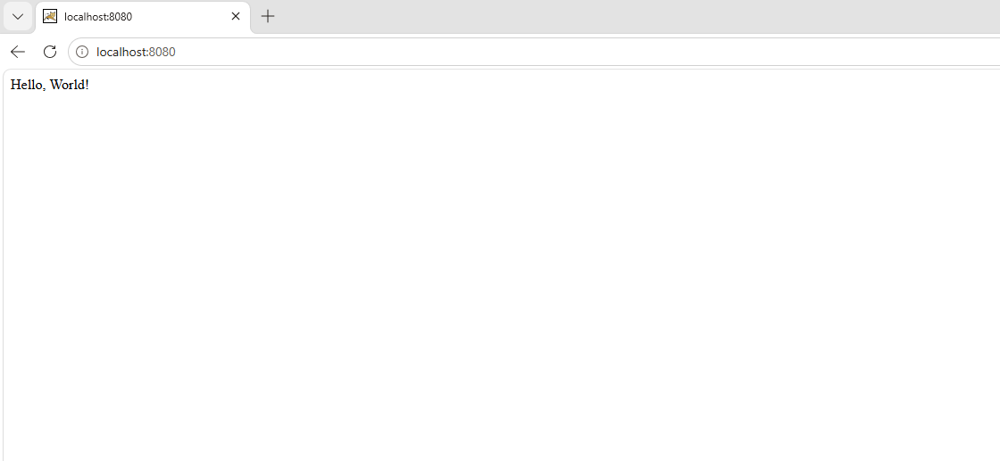

Лабораторная работа №1. Введение в Spring Boot
Выполнил: Заико Алесандр
Группа: 12002453

Цель работы
Получить практические навыки работы с Spring Framework: создание проекта, настройка зависимостей, разработка REST-контроллера с CRUD-операциями и выполнение дополнительных заданий.

Стек технологий
Язык: Java 17/21

Фреймворк: Spring Boot 3.x

Сборка: Maven

Инструменты: IntelliJ IDEA, PowerShell, Spring Initializr

powershell
.\mvnw.cmd spring-boot:run
Приложение будет доступно по адресу: http://localhost:8080

Реализованные API эндпоинты
В рамках работы реализован REST-контроллер MessageController, который поддерживает следующие операции:

Метод	URL	Описание
GET	/	Приветственное сообщение

GET	/messages	Получить все сообщения

POST	/messages	Добавить новое сообщение

PUT	/messages/{index}	Обновить сообщение по индексу

DELETE	/messages/{index} Удалить сообщение по индексу 

Дополнительное задание

Метод	URL	Описание	

GET	/messages/count	Получить общее количество сообщений	

DELETE	/messages	Очистить список всех сообщений

    private List<String> userMessages = new ArrayList<>();

    @GetMapping("/")
    public String helloWorld() {
        return "Hello, World!";
    }

    @GetMapping("/messages")
    public List<String> getAllMessages() {
        return userMessages;
    }

    @PostMapping("/messages")
    public String publishMessage(@RequestBody String message) {
        userMessages.add(message);
        return "Message published successfully!";
    }

    @PutMapping("/messages/{index}")
    public String updateMessage(@PathVariable int index, @RequestBody String message) {
        if (index >= 0 && index < userMessages.size()) {
            userMessages.set(index, message);
            return "Message updated successfully!";
        }
        return "Message not found at index " + index;
    }

    @DeleteMapping("/messages/{index}")
    public String deleteMessage(@PathVariable int index) {
        if (index >= 0 && index < userMessages.size()) {
            userMessages.remove(index);
            return "Message deleted successfully!";
        }
        return "Message not found at index " + index;
    }

    // --- Дополнительное задание ---

    //  Очистить все сообщения
    @DeleteMapping("/messages")
    public String clearAllMessages() {
        userMessages.clear();
        return "All messages cleared successfully!";
    }

    //  Подсчитать количество сообщений
    @GetMapping("/messages/count")
    public int countMessages() {
        return userMessages.size();
    }
}
}

Вывод
В ходе выполнения лабораторной работы был изучен фреймворк Spring Boot. Освоен процесс создания проекта через Spring Initializr, настройка файла pom.xml и написание REST-контроллера. Реализованы базовые CRUD-операции. В качестве дополнительного задания были релизоватны: метод для полной очистки списка сообщений и метод для подсчета текущего количества сообщений. Работа приложения успешно проверена через браузер и консоль