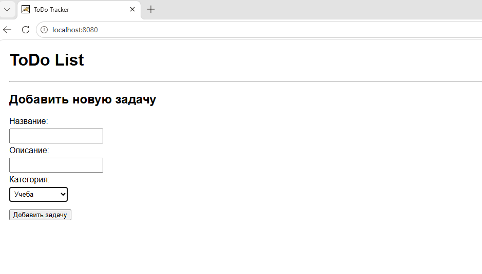
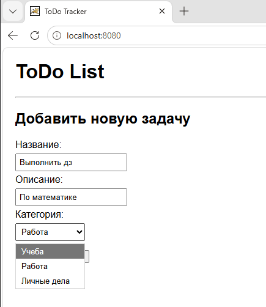
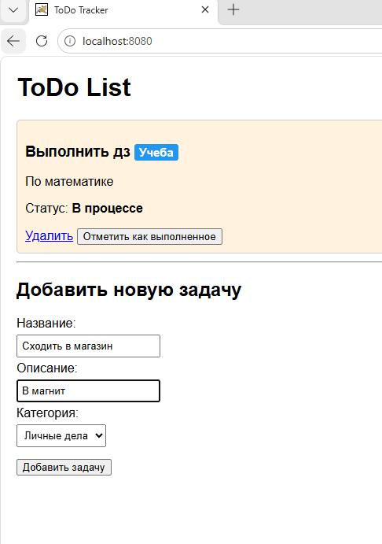
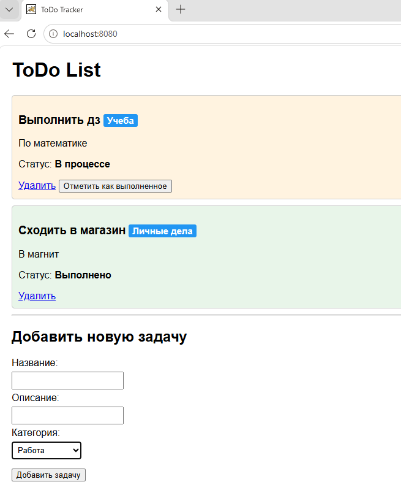

# Лабораторная работа №2. Spring MVC

**Выполнил:** [Заико Александр]  
**Группа:** [12002453]

##  Цель работы
Получить практические навыки работы с Spring Framework. Изучить архитектурный шаблон MVC (Model-View-Controller) на примере создания веб-приложения To-Do List с использованием шаблонизатора Thymeleaf.

##  Стек технологий
*   **Язык:** Java 17/21
*   **Фреймворк:** Spring Boot 3.x (Spring MVC)
*   **Шаблонизатор:** Thymeleaf
*   **Сборка:** Maven
*   **Инструменты:** IntelliJ IDEA

---

Структура проекта
В проекте реализован паттерн MVC:

Model (Модель): Task.java — хранит данные о задаче.

View (Представление): index.html — HTML-шаблон с разметкой Thymeleaf.

Controller (Контроллер): TaskController.java — обрабатывает HTTP-запросы.

Также выделены слои TaskService (бизнес-логика) и TaskRepository (хранение данных в памяти).

 Дополнительное задание (Вариант 1)
Задание: Разработать функционал для создания категорий задач (например, "Учеба", "Личные дела", "Работа").

Как это реализовано:

В модель Task.java добавлено поле String category.

В контроллере TaskController.java метод добавления задачи принимает объект Task со всеми полями, включая категорию.

В шаблоне index.html добавлен выпадающий список <select> для выбора категории. Выбранная категория отображается рядом с названием задачи в виде стилизованного бейджа.

Ключевые фрагменты кода
1. Модель Task.java (фрагмент)
   java
   public class Task {
   private Long id;
   private String title;
   private String description;
   private String category; 
   private boolean completed;

   public Task() {
   this.id = generateId();
   }

   public Task(String title, String description, String category) {
   this.id = generateId();
   this.title = title;
   this.description = description;
   this.category = category;
   this.completed = false;
   }
   // ... геттеры и сеттеры
   }
2. Контроллер TaskController.java (фрагмент)
   java
   @Controller
   public class TaskController {
   private final TaskService taskService;

   public TaskController(TaskService taskService) {
   this.taskService = taskService;
   }

   @GetMapping("/")
   public String index(Model model) {
   model.addAttribute("tasks", taskService.getAllTasks());
   return "index";
   }

   @PostMapping("/addTask")
   public String addTask(@ModelAttribute Task task) {
   taskService.addTask(task);
   return "redirect:/";
   }
   // ... методы удаления и обновления статуса
   }
3. Шаблон index.html (форма добавления с категорией)
   html
   <h2>Добавить новую задачу</h2>
<form th:action="@{/addTask}" method="post">
    

        <label for="title">Название:</label> 
        <input type="text" id="title" name="title" required>
    

    

        <label for="description">Описание:</label> 
        <input type="text" id="description" name="description" required>
    

    

        <label for="category">Категория:</label> 
        <select id="category" name="category">
            <option value="Учеба">Учеба</option>
            <option value="Работа">Работа</option>
            <option value="Личные дела">Личные дела</option>
        </select>
    

    <button type="submit" style="margin-top: 10px;">Добавить задачу</button>
</form>

Скриншоты работы программы

1. Главная страница 

  

2. Добавление новой задачи с выбором категории:

   

   

3. Отметка задачи как выполненной:

   

 Вывод
В ходе выполнения лабораторной работы было разработано веб-приложение To-Do List на базе Spring MVC и Thymeleaf. Изучен принцип разделения ответственности (Model-View-Controller): контроллер принимает запросы, сервис содержит бизнес-логику, репозиторий управляет данными, а Thymeleaf отвечает за отображение. В рамках дополнительного задания успешно реализован функционал категоризации задач, что позволяет структурировать список дел.