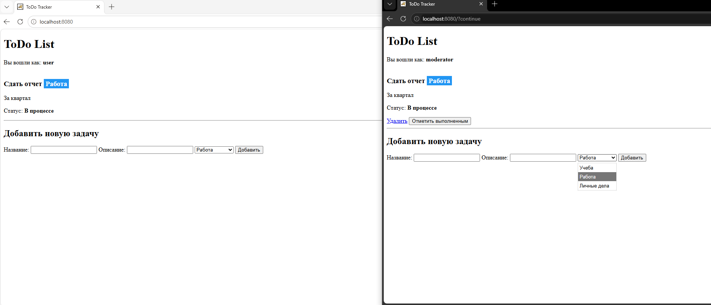
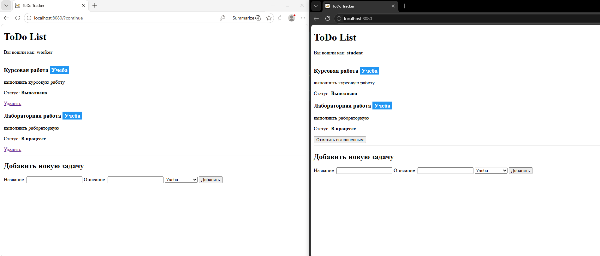

# Лабораторная работа №3. Spring Security

**Выполнил:** [Заико Александр]  
**Группа:** [12002453]

##  Цель работы
Получить практические навыки работы с Spring Framework. Изучить архитектурный шаблон MVC (Model-View-Controller) на примере создания веб-приложения To-Do List с использованием шаблонизатора Thymeleaf.

##  Стек технологий
*   **Язык:** Java 17/21
*   **Фреймворк:** Spring Boot 3.x (Spring MVC, Spring Security)
*   **Шаблонизатор:** Thymeleaf (с расширением Spring Security)
*   **Сборка:** Maven
*   **Инструменты:** IntelliJ IDEA

---
USER -	Может только просматривать список и добавлять новые задачи.

MODERATOR -	Может всё: просматривать, добавлять, удалять и менять статус задач.

STUDENT - Может добавлять задачи и менять их статус (отмечать выполненными).

WORKER	- Может добавлять задачи и удалять их.

1.  Настройка безопасности SecurityConfig.java
```java
@Configuration
@EnableWebSecurity
@EnableMethodSecurity
public class SecurityConfig {

   @Bean
   public PasswordEncoder passwordEncoder() {
      return new BCryptPasswordEncoder();
   }

   @Bean
   public InMemoryUserDetailsManager userDetailsService(PasswordEncoder passwordEncoder) {
      UserDetails user = User.builder()
              .username("user")
              .password(passwordEncoder.encode("password"))
              .roles("USER")
              .build();

      UserDetails moderator = User.builder()
              .username("moderator")
              .password(passwordEncoder.encode("password"))
              .roles("MODERATOR")
              .build();

      // Доп. задание: новые роли
      UserDetails student = User.builder()
              .username("student")
              .password(passwordEncoder.encode("password"))
              .roles("STUDENT")
              .build();

      UserDetails worker = User.builder()
              .username("worker")
              .password(passwordEncoder.encode("password"))
              .roles("WORKER")
              .build();

      return new InMemoryUserDetailsManager(user, moderator, student, worker);
   }
}
   
   ```
  
2. Ограничение доступа в TaskController.java
```java
  // Удалять могут только MODERATOR и WORKER
@PreAuthorize("hasAnyRole('MODERATOR', 'WORKER')")
@GetMapping("/deleteTask/{id}")
public String deleteTask(@PathVariable Long id) {
   taskService.deleteTask(id);
   return "redirect:/";
}

// Менять статус могут только MODERATOR и STUDENT
@PreAuthorize("hasAnyRole('MODERATOR', 'STUDENT')")
@PostMapping("/updateTask/{id}")
public String updateTask(@PathVariable Long id, @RequestParam boolean completed) {
   // ... логика обновления
   return "redirect:/";
}
   ```

3. Скрытие элементов интерфейса в index.html
```html
  <!-- Ссылка "Удалить" видна только Модератору и Работнику -->
<a th:href="@{/deleteTask/{id}(id=${task.id})}"
   sec:authorize="hasAnyRole('MODERATOR', 'WORKER')">Удалить</a>

<!-- Кнопка "Выполнено" видна только Модератору и Студенту -->
<form th:action="@{/updateTask/{id}(id=${task.id})}" method="post"
      style="display:inline;" sec:authorize="hasAnyRole('MODERATOR', 'STUDENT')">
   <input type="hidden" name="completed" value="true">
   <button type="submit" th:if="${!task.completed}">Отметить выполненным</button>
</form>

```
Скриншоты работы программы

1. Окно авторизации 


2. Роли moderator и user




3. Роли student и worker

 

 Вывод:
 
 В ходе выполнения лабораторной работы было настроено разграничение прав доступа с помощью Spring Security. Реализована аутентификация на основе формы входа и авторизация с использованием ролей (USER, MODERATOR). В рамках дополнительного задания были успешно добавлены роли STUDENT и WORKER, которые используют функционал из предыдущей лабораторной работы. С помощью аннотации @PreAuthorize и шаблонизатора Thymeleaf (sec:authorize) реализовано скрытие недоступных элементов интерфейса для разных категорий пользователей.
