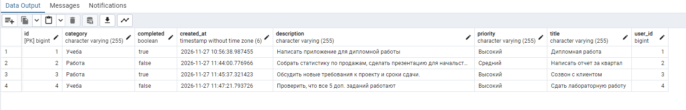
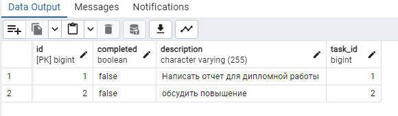
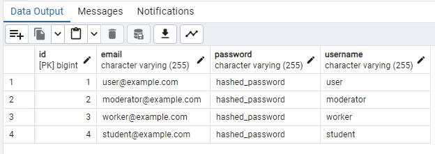
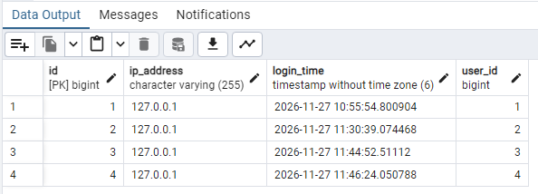
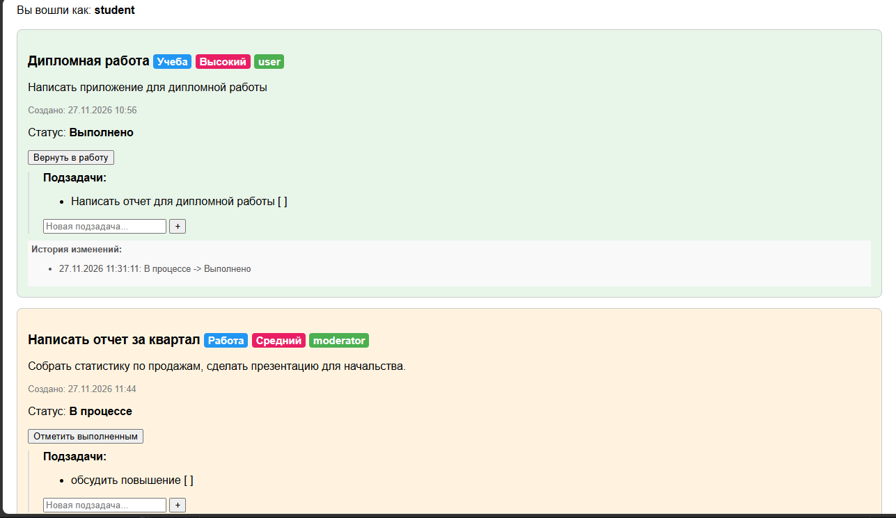
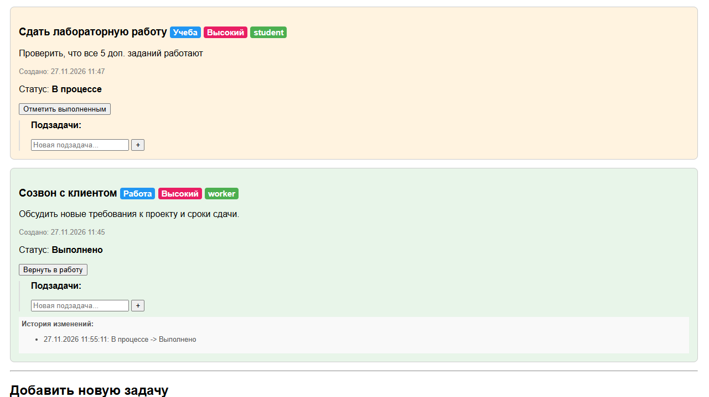

# Лабораторная работа №4. Взаимодействие Spring и PostgreSQL

**Выполнил:** [Заико Александр]  
**Группа:** [12002453]

##  Цель работы
Получить практические навыки работы с Spring Framework. Интегрировать базу данных PostgreSQL в веб-приложение на Spring Boot с использованием Spring Data JPA и Hibernate.

##  Стек технологий
*   **Язык:** Java 17/21
*   **Фреймворк:** Spring Boot 3.x (Spring MVC, Spring Security, Spring Data JPA))
*   **Шаблонизатор:** Thymeleaf
*   **Сборка:** Maven
*   **База данных:** PostrgeSQL

---
 
Ключевые фрагменты кода

1.  Запись истории входа
```java
@Component
public class LoginListener implements ApplicationListener<AuthenticationSuccessEvent> {
 @Autowired
 private LoginHistoryRepository loginHistoryRepository;

 @Override
 public void onApplicationEvent(AuthenticationSuccessEvent event) {
  String username = event.getAuthentication().getName();
  // ... логика поиска/создания User
  LoginHistory history = new LoginHistory();
  history.setLoginTime(LocalDateTime.now());
  history.setIpAddress("127.0.0.1");
  history.setUser(user);
  loginHistoryRepository.save(history);
 }
}
   
   ```
  
2. Запись истории задачи
```java
 @PostMapping("/updateTask/{id}")
public String updateTask(@PathVariable Long id, @RequestParam boolean completed) {
 Task task = taskRepository.findById(id).orElseThrow();

 TaskHistory history = new TaskHistory();
 history.setChangeTime(LocalDateTime.now());
 history.setOldState(task.isCompleted() ? "Выполнено" : "В процессе");
 history.setNewState(completed ? "Выполнено" : "В процессе");
 history.setTask(task);
 taskHistoryRepository.save(history);

 task.setCompleted(completed);
 taskRepository.save(task);
 return "redirect:/";
}
   ```

3. Связи в сущности
```java
@Entity
@Table(name = "tasks")
public class Task {
 // ... поля

 @ManyToOne
 @JoinColumn(name = "user_id")
 private User user;

 @OneToMany(mappedBy = "task", cascade = CascadeType.ALL, orphanRemoval = true)
 private List<SubTask> subTasks = new ArrayList<>();

 @OneToMany(mappedBy = "task", cascade = CascadeType.ALL, orphanRemoval = true)
 private List<TaskHistory> histories = new ArrayList<>();
}
```
Скриншоты работы программы

1. Таблица TASKS



2. Таблица SUBTASKS




3. ТАблица USERS



4.  Таблица LOGINHISTORY



5.  Таблица TASKHISTORY


6. Интерфейс

   


 Вывод:

 В ходе выполнения лабораторной работы было настроено взаимодействие Spring Boot приложения с базой данных PostgreSQL. Освоены механизмы ORM (Hibernate) и Spring Data JPA. Были успешно реализованы все 5 дополнительных заданий, включая проектирование сложных связей между таблицами (Один-ко-Многим), обработку событий безопасности для логирования входов и отслеживание истории изменений задач.