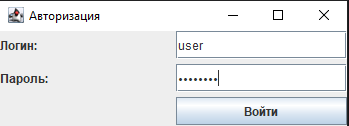
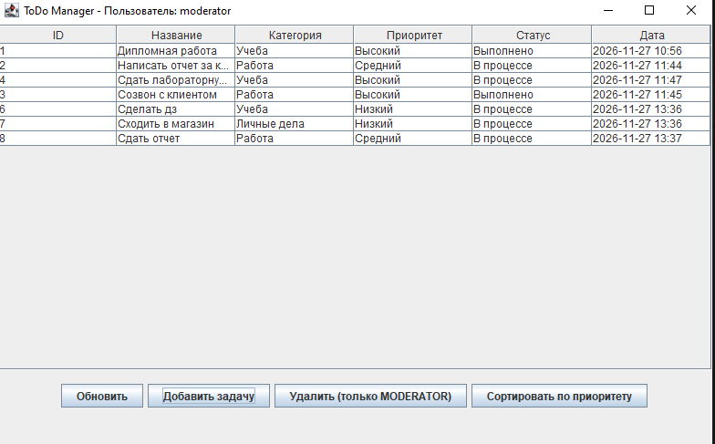
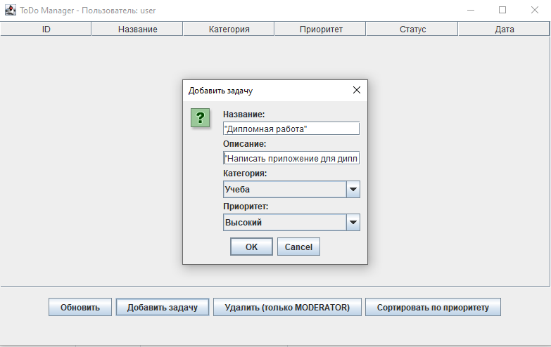
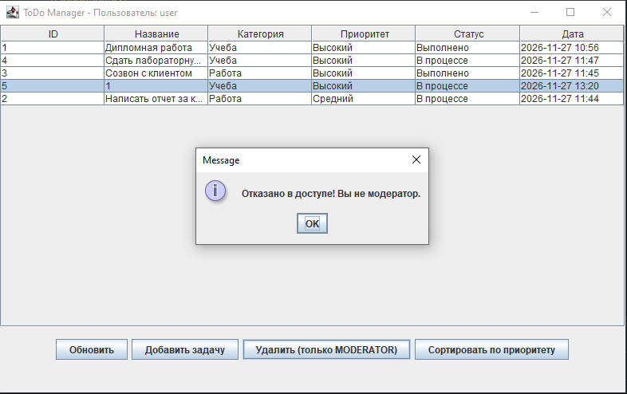
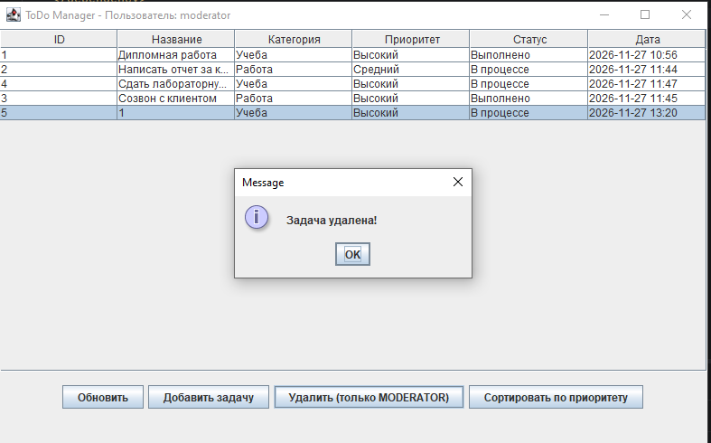
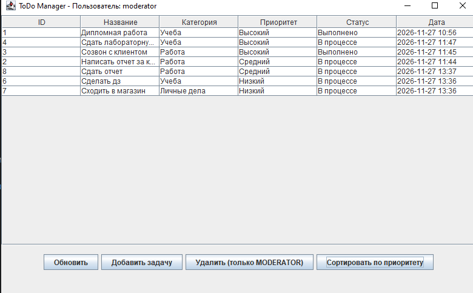

# Лабораторная работа №5. Разработк3а клиента

**Выполнил:** [Заико Александр]  
**Группа:** [12002453]

##  Цель работы
Получить практические навыки работы с Spring Framework. Разработать десктопное клиентское приложение на Java Swing, взаимодействующее с сервером Spring Boot по REST API..

##  Стек технологий
*   **Сервер:** Java 17/21, Spring Boot 3.x, Spring Security (Basic Auth), PostgreSQL.
*   **Клиент:** Java 17/21, Java Swing, Java 11 HttpClient, Gson (для работы с JSON).
*   **Сборка:** Maven (сервер), IntelliJ (клиент).


---
 
Ключевые фрагменты кода

1.  REST API на сервере 
```java
@GetMapping("/api/tasks")
public ResponseEntity<List<Task>> getAllTasksApi() {
    return ResponseEntity.ok(taskRepository.findAll());
}

@PostMapping("/api/tasks")
public ResponseEntity<Task> createTaskApi(@RequestBody Task task, Principal principal) {
    User user = userRepository.findByUsername(principal.getName());
    task.setUser(user);
    return ResponseEntity.ok(taskRepository.save(task));
}

@DeleteMapping("/api/tasks/{id}")
@PreAuthorize("hasRole('MODERATOR')")
public ResponseEntity<?> deleteTaskApi(@PathVariable Long id) {
    taskRepository.deleteById(id);
    return ResponseEntity.ok().build();
}
   
   ```
  
2. Настройка Basic Auth на сервере
```java
 @Bean
public SecurityFilterChain filterChain(HttpSecurity http) throws Exception {
    http
            .csrf(csrf -> csrf.disable()) // Важно для клиента
            .authorizeHttpRequests(auth -> auth.anyRequest().authenticated())
            .httpBasic(Customizer.withDefaults());
    return http.build();
}
   ```

3. Авторизация и отправка запросов на клиенте
```java
// Кодирование логина/пароля
String authHeader = Base64.getEncoder().encodeToString((username + ":" + password).getBytes());

// Отправка GET-запроса с заголовком Authorization
HttpRequest request = HttpRequest.newBuilder()
        .uri(URI.create("http://localhost:8080/api/tasks"))
        .header("Authorization", "Basic " + authHeader)
        .GET()
        .build();

HttpResponse<String> response = client.send(request, HttpResponse.BodyHandlers.ofString());
```
Скриншоты работы программы

1. Форма авторизации клиента:



2. Главное окно с таблицей задач




3. Окно добавления новой задачи



4.  Проверка прав: попытка удаления под пользователем

  

5.  Сортировка задач по приоритету




 Вывод:

В ходе выполнения лабораторной работы было разработано клиент-серверное приложение. Сервер на базе Spring Boot предоставляет REST API с защитой через Basic Authentication. Клиент на Java Swing успешно взаимодействует с сервером: отправляет запросы на получение, добавление и удаление данных, а также корректно обрабатывает ответы сервера (включая ошибки авторизации). Все дополнительные задания выполнены: реализован ввод/вывод расширенных данных, сортировка, добавление, удаление с проверкой ролей и улучшенный интерфейс.